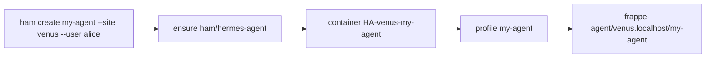

# Hermes Agent Manager

Tracer bullet: one command installs one named agent linked to an FM site.

```bash
ham create my-agent --site venus.localhost --user alice
```

FM site network binding is in [005-fm-bridge.md](005-fm-bridge.md). OpsAi gateway is in [006-opsai-remote-gateway.md](006-opsai-remote-gateway.md). Host data layout is in [004-frappe-agent-data.md](004-frappe-agent-data.md). Site-scoped bench/filesystem (`--developer`) is in [007-developer-mode.md](007-developer-mode.md).

## Behavior

`ham create <agent-name> --site <fm-site> --user <dashboard-user>` talks to the host Docker CLI and does this, in order:

1. Reject an invalid name (Docker container names: start with a letter or digit, then letters, digits, `_`, `.`, `-`).
2. Resolve FM site (`--site` or interactive pick) and dashboard username (`--user` or interactive prompt).
3. Derive names from the agent argument and site. For `ham create my-agent --site venus.localhost`:
   - container `HA-venus-my-agent`
   - Hermes profile `my-agent`
   - network alias `venus-my-agent`
   - data dir `~/frappe/frappe-agent/venus.localhost/my-agent/`
4. Fail if `docker` is missing, if the container/data directory already exists, or if the dashboard host port collides.
5. Ensure workstation image `ham/hermes-agent:latest` (build from packaged Dockerfile if missing; base is `nousresearch/hermes-agent:latest`). See [003-workstation-image.md](003-workstation-image.md).
6. Create the host data directory (markers + Hermes home) and run a detached gateway labeled under compose project `frappe-agents`:

```bash
docker run -d \
  --name HA-venus-my-agent \
  --hostname my-agent.localhost \
  --label com.docker.compose.project=frappe-agents \
  --restart unless-stopped \
  -v ~/frappe/frappe-agent/venus.localhost/my-agent:/opt/data \
  -p 127.0.0.1:<host-port>:9119 \
  -e HERMES_UID=<current uid> \
  -e HERMES_GID=<current gid> \
  --add-host venus.localhost:host-gateway \
  -e HERMES_HOME=/opt/data \
  -e HAM_AGENT=my-agent \
  -e FM_SITE=venus.localhost \
  -e FRAPPE_URL=http://venus.localhost \
  -e HERMES_DASHBOARD=1 \
  -e HERMES_DASHBOARD_BASIC_AUTH_USERNAME=alice \
  ham/hermes-agent:latest \
  gateway run
```

7. Wait until the container is running, create the profile, join the FM site network as `venus-my-agent`, and record env into `/opt/data/.env`.

```bash
docker exec --workdir /opt/data -e HERMES_HOME=/opt/data \
  HA-venus-my-agent hermes profile create my-agent
```

Each long step prints a status line while it runs, then a check mark when it finishes. A failed step prints a cross and the error.



## Layout

Python package, Typer, pytest. Install the command with `uv tool install .`. Docker is invoked with `subprocess` so the VPS only needs the `docker` binary.

- [pyproject.toml](../pyproject.toml) — package `hermes-agent-manager`, deps `typer`, dev `pytest`
- `hermes_agent_manager/cli.py` — `ham` entry point
- `hermes_agent_manager/agent_name.py` — name validation and site-aware container/alias
- `hermes_agent_manager/agent_paths.py` — `frappe-agent/<site>/<agent>` paths
- `hermes_agent_manager/dashboard_user.py` — dashboard username input
- `hermes_agent_manager/installer.py` — install sequence
- `hermes_agent_manager/docker_runner.py` — subprocess wrapper around `docker`
- `tests/` — fake runner records the exact `docker` argv; no daemon required

## Tests

- Valid and invalid names; site-slug strips `.localhost`
- Install argv: container `HA-<site-slug>-<agent>`, bind mount path, compose project label, uid/gid, dashboard user env, network connect alias
- Refuses existing container/data directory and missing `--user` when non-interactive
- Surfaces a clear error when `docker` is not on `PATH`

API keys are not prompted. They are set later in `/opt/data/.env`. The official image reads that file from the volume.

## Out of scope

- Interactive setup wizard beyond site/user prompts
- Frappe User / API key provisioning inside the site
