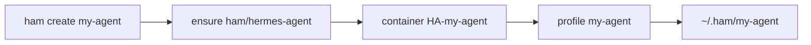

# Hermes Agent Manager

Tracer bullet: one command installs one named agent. No wizard, no lifecycle commands yet.

```bash
ham create my-agent
```

## Behavior

`ham create <agent-name>` talks to the host Docker CLI and does this, in order:

1. Reject an invalid name (Docker container names: start with a letter or digit, then letters, digits, `_`, `.`, `-`).
2. Derive two names from the argument. For `ham create my-agent`, the container is `HA-my-agent` and the Hermes profile is `my-agent`. The data directory stays keyed by the profile name.
3. Fail if `docker` is missing, if container `HA-<agent-name>` already exists, or if the data directory already exists.
4. Ensure workstation image `ham/hermes-agent:latest` (build from packaged Dockerfile if missing; base is `nousresearch/hermes-agent:latest`). See [003-workstation-image.md](003-workstation-image.md).
5. Create `~/.ham/<agent-name>` and run a detached gateway. This matches the official [one container per profile](https://hermes-agent.nousresearch.com/docs/user-guide/docker) layout (distinct container name and volume; never share `~/.hermes` across containers):

```bash
docker run -d \
  --name HA-<agent-name> \
  --restart unless-stopped \
  -v ~/.ham/<agent-name>:/opt/data \
  -e HERMES_UID=<current uid> \
  -e HERMES_GID=<current gid> \
  -e HERMES_HOME=/opt/data \
  ham/hermes-agent:latest \
  gateway run
```

6. Wait until `HA-<agent-name>` is running, then create the profile inside that container. `HERMES_HOME` is `/opt/data` (the mounted volume), so a Hermes install on the host machine is not used. Do not start a second gateway. The container's `gateway run` process serves every profile in that volume, including the one just created:

```bash
docker exec --workdir /opt/data -e HERMES_HOME=/opt/data \
  HA-<agent-name> hermes profile create <agent-name>
```

The container name is `HA-<agent-name>`. The profile name is `<agent-name>`.

Each long step prints a status line while it runs, then a check mark when it finishes. A failed step prints a cross and the error.

Host ports stay unpublished. Messaging gateways do not need them, and publishing `8642` would collide on a second agent. Dashboard stays off (`HERMES_DASHBOARD` unset) so the install does not expose an unauthenticated UI.



## Layout

Python package, Typer, pytest. Install the command with `uv tool install .`. Docker is invoked with `subprocess` so the VPS only needs the `docker` binary.

- [pyproject.toml](../pyproject.toml) — package `hermes-agent-manager`, deps `typer`, dev `pytest`
- `hermes_agent_manager/cli.py` — `ham` entry point
- `hermes_agent_manager/agent_name.py` — name validation
- `hermes_agent_manager/installer.py` — install sequence
- `hermes_agent_manager/docker_runner.py` — subprocess wrapper around `docker`
- `tests/` — fake runner records the exact `docker` argv; no daemon required

## Tests

- Valid and invalid names
- Install argv: ensure/build `ham/hermes-agent:latest`, container `--name HA-<agent-name>`, volume path, uid/gid, `HERMES_HOME=/opt/data`, `gateway run`, then `docker exec` in `/opt/data` for profile create using `<agent-name>`
- Step messages for image ensure, data directory, container start, wait, and profile create
- Refuses an existing `HA-<agent-name>` container and an existing data directory
- Surfaces a clear error when `docker` is not on `PATH`

API keys are not prompted. They are set later in `~/.ham/<name>/.env`. The official image reads that file from `/opt/data/.env`.

## Out of scope

- Interactive setup wizard
- `list`, `start`, `stop`, and `remove`
- Published host ports and the dashboard
