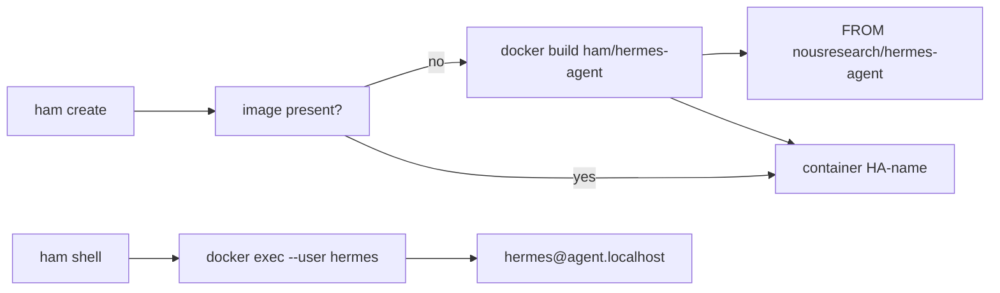

# Workstation image (beta)

Tracer bullet: `ham create` runs a FM-style fat image so `ham shell` has real CLI tools.

## Behavior

1. Ship a Dockerfile under `hermes_agent_manager/image/` that starts `FROM nousresearch/hermes-agent:latest`.
2. Install interactive packages: `vim`, `nano`, `less`, `tree`, `jq`, `sudo`, `wget`, `bash-completion`, `net-tools`, `iproute2`, `file`, `unzip`, `locales`.
3. Passwordless sudo for the image `hermes` user only (FM's `frappe` pattern). Login shell is bash.
4. System-wide bash config at `/etc/bash.bashrc.d/ham.bashrc` with `ham_host()` so the prompt is `hermes@<agent>.localhost` (FM's `frappe@venus.localhost` style).
5. Tag the built image `ham/hermes-agent:latest`.
6. `ham create` builds that tag when missing, sets `--hostname <agent>.localhost` and `HAM_AGENT=<agent>`, and keeps `HERMES_UID`/`HERMES_GID` so the `hermes` user maps to the host operator.
7. `ham build-image` force-rebuilds with `--pull` so base updates are easy to test.
8. `ham shell` / profile create always `docker exec --user hermes` (never root).

## Layout

- `hermes_agent_manager/image/Dockerfile`
- `hermes_agent_manager/image/bashrc`
- `hermes_agent_manager/image/paths.py` — resolve packaged build context
- `docker_runner.py` — `image_exists`, `build_image`; default `IMAGE` becomes `ham/hermes-agent:latest`
- `installer.py` — ensure/build instead of bare `docker pull` of the official tag
- `cli.py` — `build-image` command

## Tests

- Create builds when the ham image is absent, skips build when present, then runs the gateway with `ham/hermes-agent:latest`
- `build-image` runs `docker build --pull -t ham/hermes-agent:latest <context>`
- Create sets `--hostname <agent>.localhost` and `HAM_AGENT`
- Shell and profile create pass `--user hermes`

## Out of scope

- Publishing to a registry
- zsh / oh-my-zsh
- Migrating existing `HA-*` containers that still use the official image
